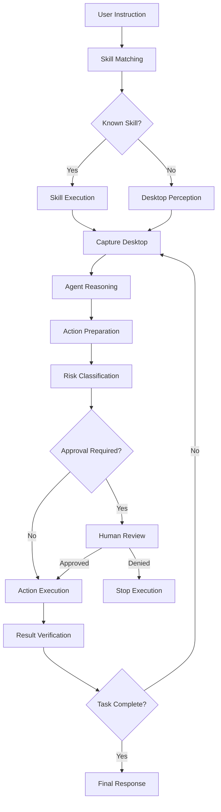

# AETHRIX — Personal Desktop AI Assistant

## About the Project

**AETHRIX** is an AI-powered Personal Desktop Assistant designed to interact with a Windows computer using natural-language instructions.

Unlike traditional chatbots that primarily generate text responses, AETHRIX aims to understand user commands, perceive the desktop environment, make decisions, execute computer actions, and verify their outcomes.

The project combines Agentic AI, Large Language Models (LLMs), computer-use automation, visual perception, and human-in-the-loop safety mechanisms into a unified desktop assistant.

The ultimate objective is to build an intelligent assistant that can understand what a user wants and perform practical computer tasks while keeping the user in control.

### Example Commands

```text
Open Microsoft Edge and Search for Latest News

Search for Python tutorials on Google.

Open File Explorer.

Take a screenshot of my desktop.

Search for LangGraph tutorials on Youtube.

Send a Whatsapp message to +920000000000 saying "Hello! How are you?"
```

These examples represent the intended interaction style; individual workflows may have different implementation and testing status.


## Project Objectives

- Understand natural-language commands.
- Convert user instructions into actionable tasks.
- Capture and analyze the desktop environment.
- Use LLM-powered reasoning to determine the next action.
- Interact with Windows applications through automation.
- Verify whether executed actions produce the expected results.
- Require human approval before potentially risky operations.
- Maintain execution history and persistent session information.
- Provide a frontend/backend architecture for interacting with the assistant.

## System Architecture

AETHRIX follows a modular, graph-based agent architecture powered by LangGraph.

### High-Level Workflow



### Core Components

#### 1. Agent Orchestration — LangGraph

The central agent workflow is implemented using LangGraph.

It coordinates multiple stages of execution through individual nodes:

- Skill matching
- Screenshot capture
- Agent reasoning
- Action preparation
- Safety classification
- Human approval
- Action execution
- Result verification

A shared state carries relevant information between nodes.

This modular approach makes the workflow easier to maintain, debug, extend, and control.

**Main file:** `agent/graph.py`

#### 2. Perception Layer

The perception layer provides information about the current desktop environment.

Its responsibilities include:

- Capturing desktop screenshots.
- Resizing screenshots for visual analysis.
- Preserving original-resolution screenshots for precise processing.
- Discovering accessible Windows UI elements.
- Providing contextual information for action selection.

The project combines visual perception with structured Windows UI Automation.

#### 3. Brain / Reasoning Layer

The reasoning component uses an LLM to interpret instructions and decide which action should happen next.

It considers:

- User instructions
- Current screenshots
- Previous actions
- Execution history
- Available skills
- Verification feedback

The model can propose actions such as clicking, typing, waiting, or finishing a task.

Model-generated actions are subject to application-level validation and safety checks before execution.

#### 4. Skills System

The skills layer provides reusable capabilities for common desktop tasks.

Examples include:

- Opening applications
- Web searching
- Opening File Explorer
- Taking screenshots
- WhatsApp-related operations

Known instructions can be matched to predefined skills rather than requiring the agent to discover every action from scratch.

**Main file:** `skills/skills.py`

#### 5. Safety and Risk Classification

AETHRIX incorporates a risk-classification system to prevent unrestricted desktop automation.

Actions are classified into three categories:

| Risk Level | Behavior |
|---|---|
| SAFE | Allowed under the configured safety policy |
| RISKY | Requires human approval |
| BLOCKED | Must not be executed |

Potentially consequential operations, such as sending messages or deleting content, require additional caution.

Safety decisions are also logged for auditing.

#### 6. Human-in-the-Loop (HITL)

AETHRIX uses LangGraph interruption and resumption capabilities to support human approval.

The workflow is designed to:

1. Pause when an action requires approval.
2. Present the pending action for user review.
3. Resume execution if approved.
4. Stop the pending action if denied.

This provides an additional layer of control over potentially risky computer operations.

#### 7. Windows UI Automation

The project uses Pywinauto with the Windows UI Automation backend.

It can discover structured interface information, including:

- Element names
- Control types
- Automation IDs
- Bounding rectangles
- Enabled states
- Window metadata

For example, Windows Calculator exposes a button with the automation ID:

```python
num5Button
```

A UIA interaction can locate the corresponding element and invoke it.

The implementation also includes active-window validation to reduce the risk of interacting with the wrong application.

**Main file:** `perception/uia.py`

#### 8. Action Verification

AETHRIX does not assume that issuing an automation command means the task has succeeded.

The verification stage examines changes in the desktop state and provides feedback to the agent.

This helps the workflow determine whether it should continue, retry within configured limits, or stop.

Application-specific semantic verification remains an area for improvement.

#### 9. Backend Runtime

The backend provides the execution interface between the frontend and the LangGraph agent.

Its responsibilities include:

- Managing agent execution.
- Tracking active runs.
- Handling approval responses.
- Coordinating execution state.
- Managing runtime errors and cleanup.

**Main file:** `api/runtime.py`

#### 10. Memory and Persistence

The project uses SQLite-based persistence for information such as:

- Sessions
- Execution steps
- Confirmation records
- Decision history

This creates a foundation for execution auditing and future conversation-continuity capabilities.

## Technology Stack

| Technology | Purpose |
|---|---|
| Python | Core programming language |
| LangGraph | Agent workflow orchestration |
| LangChain | LLM and tool integration |
| Groq | LLM inference |
| FastAPI | Backend API |
| Pywinauto | Windows UI Automation |
| PyAutoGUI | Desktop interaction |
| MSS | Screenshot capture |
| Pillow | Image processing |
| SQLite | Persistent storage |
| Whisper | Speech recognition |
| Edge TTS | Text-to-speech |
| Pygame | Audio playback |

## Safety and Reliability Principles

AETHRIX is being developed around several important engineering principles:

- **Controlled execution:** Actions are prepared and validated before execution.
- **Human oversight:** Risky operations require approval.
- **Window validation:** UI Automation should interact with the intended application.
- **Bounded execution:** Configured execution limits help prevent uncontrolled loops.
- **Error handling:** Failures should stop or recover safely.
- **Action verification:** The system should inspect results before reporting success.
- **Auditability:** Important execution and safety decisions are recorded.


## Installation and Setup

### Prerequisites

- Windows 10 or Windows 11
- Python environment compatible with the installed dependencies
- Git
- Groq API key for the configured LLM integration

### 1. Clone the Repository

```powershell
git clone https://github.com/burhan-arshad/personal-desktop-agent
cd "personal-desktop-agent"
```

### 2. Create a Virtual Environment

```powershell
python -m venv venv
```

### 3. Activate the Environment

```powershell
.\venv\Scripts\Activate.ps1
```

### 4. Install Dependencies

```powershell
python -m pip install -r requirements.txt
```

### 5. Configure Environment Variables

Create a `.env` file in the project root:

```env
GROQ_API_KEY=your_groq_api_key
```

Never commit API keys or sensitive credentials to version control.

### 6. Run the Agent

The graph module has been used directly during development:

```powershell
python agent/graph.py
```

The final integrated frontend/backend startup instructions will be added after the runtime configuration is finalized.

## Development Status

AETHRIX is an actively developed project.

### Implemented Foundations

- LangGraph-based agent orchestration.
- Natural-language skill matching.
- Predefined desktop skills.
- Screenshot capture and perception workflow.
- SAFE, RISKY, and BLOCKED risk classification.
- Human-in-the-loop approval workflow.
- SQLite-based execution and session logging.
- Windows UI Automation element discovery.
- UIA interaction helpers.
- Backend runtime and approval-response integration.
- Voice input/output components.

### Areas Requiring Further Validation

- Reliable multi-step desktop execution.
- Application-specific semantic verification.
- Frontend/backend regression testing.
- Persistent conversation restoration.
- Robust recovery from failed or interrupted tasks.
- Consistent automation across different Windows applications.

### Known Limitation

The Calculator compound workflow currently opens Calculator, but the subsequent click on the number 5 button is not reliably completing through the integrated agent workflow.

Standalone UIA element discovery and button invocation have been verified separately. The integrated workflow issue remains under investigation.

## Future Roadmap

- Improve multi-step desktop task reliability.
- Expand Windows UI Automation support.
- Improve semantic action verification.
- Strengthen persistent memory and conversation continuity.
- Improve runtime error recovery.
- Expand automated testing and regression coverage.
- Improve frontend execution visibility.
- Add more desktop skills while maintaining safety controls.
- Publish a complete architecture and demonstration guide.

## Engineering Concepts Explored

This project combines several areas of AI and software engineering:

- Agentic AI
- Large Language Models
- LLM inference and tool calling
- Graph-based workflow orchestration
- Stateful execution
- Computer-use agents
- Visual perception
- Windows UI Automation
- Human-in-the-loop systems
- REST APIs and backend development
- Concurrency and synchronization
- Database persistence
- Software testing and reliability engineering

## Project Philosophy

An AI desktop assistant should not blindly execute every instruction suggested by a language model.

It should understand the task, inspect its environment, prepare an appropriate action, evaluate its risk, involve the user when necessary, and verify the outcome.

AETHRIX explores how these components can work together to create a safer and more capable personal desktop assistant.

---

## Author

**Burhan Arshad**

Aspiring AI/ML Engineer | Computer Science Student

- GitHub: [@burhan-arshad](https://github.com/burhan-arshad)
- Portfolio: [burhan.cypherai.tech](https://burhan.cypherai.tech)
